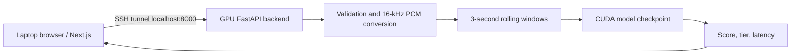

# VoiceGuard: Real-Time Voice Deepfake Detection

VoiceGuard is a research and demonstration system for detecting synthetic speech in authorized VoIP-style streams. It accepts 16-kHz mono audio, forms three-second rolling windows, runs the configured GPU model, and returns a calibrated spoof probability and risk tier.

The current demonstration is offline: it does not dial a phone, contact DotVoice, inject packets into a live RTP stream, or persist raw audio. The browser uploads a human or AI recording in memory, packetizes it into 20-ms RTP-like frames, sends rolling PCM16 windows to the GPU backend, and displays packet events, model output, tier, model version, and latency.

## Architecture



The frontend runs on the laptop because Node.js dependencies are not installed on the GPU machine. Python, PyTorch, the checkpoint, and inference remain on the GPU machine.

## One-time setup

### GPU machine

```bash
cd ~/noidea
source .venv/bin/activate
python -m pip install -e .

export MODEL_CHECKPOINT=artifacts/checkpoints/best.pt
export MODEL_CONFIG_PATH=configs/model.yaml
export THRESHOLDS_PATH=artifacts/calibration/thresholds.json
export MODEL_DEVICE=cuda
export ALLOWED_ORIGINS=http://localhost:3000
```

### Laptop

Copy or clone this repository on the laptop. Only the frontend dependencies are required there:

```bash
cd ~/noidea/frontend
npm install
```

The laptop does not need CUDA, PyTorch, Redis, MongoDB, or the model checkpoint.

## Run the split demo

### 1. Start the backend on the GPU machine

```bash
cd ~/noidea
source .venv/bin/activate
./start.sh
```

The backend listens on GPU port `8000` and writes logs to `logs/backend.log`.

Verify it on the GPU machine:

```bash
curl http://127.0.0.1:8000/healthz
curl http://127.0.0.1:8000/readyz
```

`/readyz` should report `"model_loaded": true`. If it does not, check the three model environment variables above.

### 2. Forward the backend port to the laptop

Run this on the laptop and keep it open:

```bash
ssh -N -L 8000:127.0.0.1:8000 muthu@GPU_MACHINE_IP
```

Or use the launcher:

```bash
GPU_SSH_TARGET=muthu@GPU_MACHINE_IP ./start.sh tunnel
```

Test the tunnel on the laptop:

```bash
curl http://127.0.0.1:8000/healthz
```

### 3. Start the frontend on the laptop

In a second laptop terminal:

```bash
cd ~/noidea
NEXT_PUBLIC_API_BASE_URL=http://localhost:8000 ./start.sh frontend
```

The frontend opens at:

```text
http://localhost:3000
```

Upload a human or AI audio file, select the matching voice path, and click **Execute simulation**. Audio is decoded and resampled in the browser, then sent to the GPU as rolling three-second PCM16 windows.

## Launcher commands

```bash
./start.sh              # GPU/backend only
./start.sh frontend     # laptop/frontend only
./start.sh tunnel       # SSH-forward GPU API; requires GPU_SSH_TARGET
./start.sh demo         # optional: backend and frontend on one machine
./start.sh status       # health and process status
./start.sh stop         # stop local processes
```

The default launcher does not start Next.js, Docker, Redis, MongoDB, or MLflow. Optional infrastructure can be enabled with `START_INFRA=1`, but it is not required for the local inference demonstration.

## API quick reference

```bash
curl http://localhost:8000/healthz
curl http://localhost:8000/readyz
curl http://localhost:8000/docs
```

The model endpoint requires exactly three seconds of PCM16 audio:

```bash
dd if=/path/to/three_seconds.pcm of=/tmp/chunk.pcm bs=1 count=96000
curl -X POST http://localhost:8000/score \
  -H 'Content-Type: application/octet-stream' \
  -H 'X-Sample-Rate: 16000' \
  --data-binary @/tmp/chunk.pcm
```

The response contains `score`, `tier`, `model_version`, and `latency_ms`. Raw scores can be hidden with `HIDE_RAW_SCORES=true`.

## Training and evaluation

The dataset CSV must contain `Location`/`Label` or `location`/`label`; labels are `0=human` and `1=AI`:

```bash
python scripts/train_neural.py --config configs/train.yaml \
  --train-csv /path/train.csv \
  --validation-csv /path/validation.csv \
  --device cuda

python scripts/calibrate_neural.py --config configs/train.yaml \
  --checkpoint artifacts/checkpoints/best.pt \
  --csv /path/validation.csv --device cuda

python scripts/evaluate_neural.py --config configs/train.yaml \
  --checkpoint artifacts/checkpoints/best.pt \
  --csv /path/test.csv \
  --calibration artifacts/calibration/calibration.json --device cuda
```

The reported baseline is an LCNN configuration. XLS-R/AASIST interfaces are prepared but were not used for the reported results. Do not treat the current held-out split result as zero-day evidence until generator-, speaker-, source-, codec-, and dataset-disjoint experiments are complete.

## Development notes

ECS EC2 GPU provides control over GPU instance capacity, WebSocket behavior, and cost tuning, but requires AMI, autoscaling, patching, and capacity management. SageMaker real-time endpoints provide managed model deployment and autoscaling, but introduce endpoint packaging constraints, per-endpoint cost, and a less direct fit for long-lived bidirectional WebSocket sessions. The checked-in Terraform defaults to parameterized ECS EC2 GPU resources; no AWS resources are created automatically. 

A GPU-Accelerated Voice Deepfake Detection and VoIP-Style Simulation System

## Developers

Debosmita Mukhopadhyay

Khushi Kumari

Muthu Amuthan

Amanjeeta Rath
